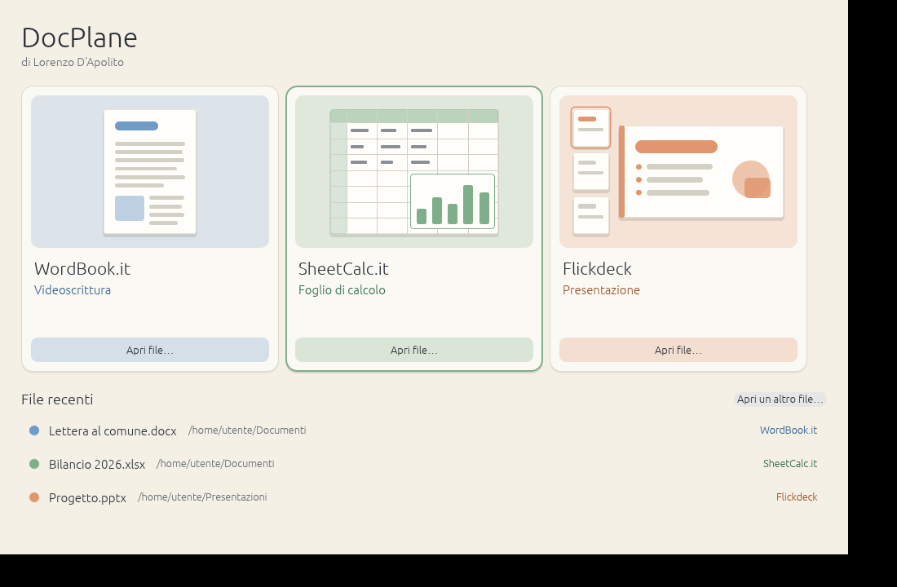

# DocPlane.it

**DocPlane.it** è il lanciatore del pacchetto di Lorenzo D'Apolito: una finestra con i tre programmi,
ognuno con la sua anteprima, il suo nome e a cosa serve.

| Programma | Serve per |
|---|---|
| **WordBook.it** | Videoscrittura |
| **SheetCalc.it** | Foglio di calcolo |
| **Flickdeck.it** | Presentazione |



## Cosa fa

- **Un clic su un programma** lo avvia con un documento vuoto.
- **Apri file…** (su ogni scheda, oppure «Apri un altro file…» in fondo) avvia il programma giusto
  in base al tipo di file: `.docx`, `.odt`, `.rtf`… in WordBook.it; `.xlsx`, `.ods`, `.csv`… in
  SheetCalc.it; `.pptx`, `.odp`… in Flickdeck.it.
- **Trascina un file sulla finestra** e si apre nel programma giusto.
- **File recenti**: l'elenco dei file aperti da DocPlane.it (gli ultimi 12). Un clic li riapre.
- **Imposta come programmi predefiniti** (in alto a destra, solo Windows): registra WordBook.it,
  SheetCalc.it e Flickdeck per i loro tipi di file, senza bisogno di essere amministratore, e apre la
  pagina «App predefinite» di Windows. Windows 10 e 11 vogliono la conferma dell'utente per cambiare
  un programma predefinito: lì si controllano e si approvano i tre programmi.
- **Dizionari** (riga sotto le schede): ortografia, sinonimi e sillabazione condivisi da tutti e tre i
  programmi, in italiano e inglese. Il pulsante «Scarica i dizionari» li scarica nella cartella
  `dictionaries`; ogni programma la trova da solo e DocPlane.it gliela indica quando lo avvia.
- Se un programma non è accanto a DocPlane.it, la scheda dice «non trovato».

DocPlane.it cerca i programmi nella sua stessa cartella (`WordBook.it.exe`, `SheetCalc.it.exe`,
`Flickdeck.it.exe`), in una cartella con il nome del programma o in `programmi`.

## Il pacchetto per Windows

Sono tre programmi più il lanciatore, tutti nella stessa cartella:

```
DocPlane.it\
  DocPlane.it.exe
  WordBook.it.exe
  SheetCalc.it.exe
  Flickdeck.it.exe
  dictionaries\         (dizionari condivisi dai tre programmi)
  portable.txt          (SheetCalc.it: impostazioni accanto al programma)
  docplane-data\        (DocPlane.it)
  wordbook-data\        (WordBook.it)
  flickdeck-data\       (Flickdeck.it)
  sheetcalc-data\       (SheetCalc.it)
```

Con le cartelle `*-data` e il file `portable.txt` tutto è portatile: impostazioni e file recenti
restano nella cartella, che si può mettere su una chiavetta. Cancellali per usare il profilo di
Windows.

### Come crearlo

Servono Rust (toolchain `x86_64-pc-windows-gnu`) e un compilatore C come
[WinLibs](https://winlibs.com) (UCRT, 64 bit), **in una cartella senza spazi nel percorso**, e Git.
Poi, nel Prompt dei comandi, dalla cartella di DocPlane.it:

```
packaging\windows\Crea-pacchetto.bat
```

Lo script scarica o aggiorna i tre programmi (cartelle accanto a quella di DocPlane.it), li compila
scarica i dizionari e crea `dist\DocPlane.it\` e `dist\DocPlane.it.zip`. La prima volta richiede circa un'ora.

Solo DocPlane.it, senza il resto: `cargo build --release -p docplane`.

## Dizionari e licenze

I dizionari non fanno parte del repository: sono scaricati dal repository
[LibreOffice/dictionaries](https://github.com/LibreOffice/dictionaries), ognuno con la propria
licenza (l'italiano, di LibreItalia, è GPL 3), e restano file di dati in una cartella a parte; i
programmi li leggono soltanto. Per aggiungere una lingua basta copiare nella cartella i file
Hunspell della lingua (per esempio `fr_FR.aff` e `fr_FR.dic`). Scaricarli senza la finestra:
`DocPlane.it.exe --scarica-dizionari "cartella"`.

## Licenza

MIT OR Apache-2.0. L'icona e le anteprime sono disegnate nel codice e sono originali. Vedi
[ATTRIBUTION.md](ATTRIBUTION.md).
